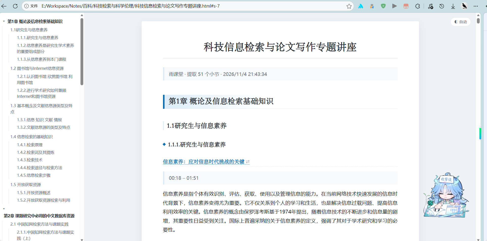
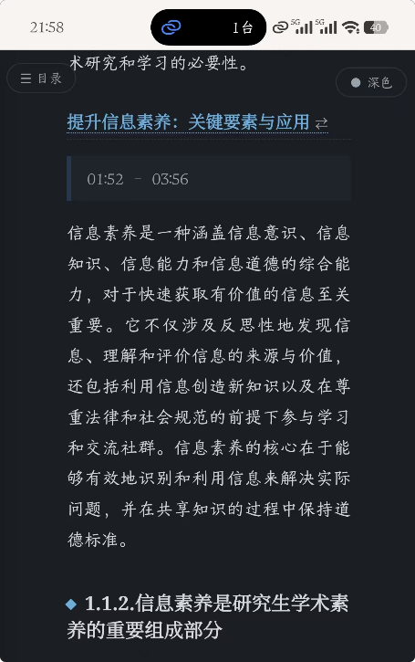

# YuKeTangNoteDownload

下载雨课堂课程的知识索引（知识导引）和讲稿，提高学习效率。

|              功能               |                             展示                             |
| :-----------------------------: | :----------------------------------------------------------: |
|          插件交互面板           |  |
| 提取笔记（电脑<br />+浅色模式） |  |
|          手机+深色模式          |  |

## 用法

不需要装插件，也不用填参数，粘贴脚本后弹面板操作。

1. 登录雨课堂，打开任意一节课程视频页，地址形如
   `https://www.yuketang.cn/ai-workspace/lms-graph/<classroom_id>/video/<leaf_id>?is_chapter=1`
2. `F12` → `Console`，把 [extract-notes.js](extract-notes.js) 的内容整段粘贴进去，回车。
3. 页面左上方出现「雨课堂笔记提取」面板，自动加载本课程目录，**默认全部勾选**。
4. 要减少范围就点章 / 节的复选框取消整组，或搜索后点「清空」再单选 → 选导出格式 → 点「开始提取」。
5. 浏览器下载 `<课程名>.md`（和可选的 `.html`）。

效果见 [sample-1.1.1-1.1.2.md](sample-1.1.1-1.1.2.md) 与 [sample-1.1.1-1.1.2.html](sample-1.1.1-1.1.2.html)，
后者双击用浏览器打开就能看到目录、排版和深浅色切换。

## 面板

| 区域 | 说明 |
| --- | --- |
| 标题栏 | 按住可拖动，位置记在 `localStorage`；`—` 收起，`×` 关闭 |
| 搜索框 | 按小节 / 章 / 节标题过滤，组勾选只作用于过滤后可见的条目 |
| 全选 / 反选 / 清空 | 只作用于当前可见条目 |
| 目录树 | 章 → 节 → 视频三级，父级复选框带半选状态，点 ▸ ▾ 展开折叠；打开时默认全选 |
| 导出格式 | `Markdown (.md)` 或 `Markdown + HTML` |
| 附带讲稿附录 | 关掉则只导出知识导引，不生成附录树 |
| 标注时间段 | 关掉则知识导引标题下不输出 `> 00:18 – 01:51` |
| 并发数 | 1~8，卡或怕限流就调小 |
| 底部 | 进度条 + 计数；提取中时按钮变成「取消」 |

再次粘贴脚本只会重新唤出面板，不会重复注入；参数和面板位置都会记住。
面板配色跟随系统深浅色。

## 导出格式

两种格式都会在正文开头生成**目录**，条目直接链到对应标题。

- **Markdown**：目录是嵌套链接列表，锚点用 `<a id>` + `[标题](#id)`，适合 GitHub、VS Code 内置预览、pandoc、静态站点。
  Obsidian 不解析 HTML 锚点，需要改用 `[[#标题]]`。
- **HTML**：单文件自包含，除正文外还有
  - **左侧固定目录栏**：章可折叠，滚动时自动高亮当前小节并展开所在章；窄屏（≤1100px）收成抽屉，点左上「☰ 目录」拉出。
  - **深色模式**：默认跟随系统 `prefers-color-scheme`，右上角 `◐ 自动 / ● 浅色 / ● 深色` 三态手动切换，选择记在 `localStorage`；
    `<head>` 里先同步读一次，避免加载时闪一下白。
  - **VLOOK 风排版**：衬线标题配无衬线正文、h2 色块左边框、时间戳药丸标签、引用条、跳转链接带 `⇄` 标记，并附打印样式，`Ctrl+P` 可直接导出 PDF。

  不依赖 Typora，浏览器双击即开，锚点一定能跳。

VLOOK 本身是 Typora 主题，它的 CSS 有 1700+ 处选择器挂在 Typora 的 `#write` DOM 上，
没法直接套到独立 HTML 里。所以这里是复刻它的排版风格，而不是复用它的文件（VLOOK 为 MIT 许可）。

## 输出结构

文档开头是目录，然后分成两棵树：正文只有知识导引，讲稿全部集中到文末的 `# 附录`。
标题层级与页面目录树的缩进一一对应，标题文字一律用目录原文，不做改写。

```
# 课程名称
> 雨课堂 · 提取 N 个小节 · 时间

## 目录

- [第N章 XXX](#s-1)
  - [1.1 XXX](#s-2)
    - [1.1.1 XXX](#s-3)
- [附录](#s-4)          ← 目录里附录永远排在最后

<a id="s-1"></a>
## 第N章 XXX
### 1.1 XXX                     ← 节
#### 1.1.1 XXX                  ← 视频小节

<a id="k-<leaf_id>-0"></a>
##### [知识导引条目标题](#a-<leaf_id>-0)   ← 点击跳到附录
> 00:18 – 01:51                 ← 对应视频时间段
摘要正文

# 附录
## 第N章 XXX
### 1.1 XXX
#### 1.1.1 XXX

<a id="a-<leaf_id>-0"></a>
##### [知识导引条目标题](#k-<leaf_id>-0)   ← 点击跳回正文
###### 00:18                    ← 该时间段内的讲稿段落
段落正文
```

跳转与分组规则：

- 目录锚点用 `s-<序号>`，只打在章 / 节 / 视频和「附录」标题上；附录树里的镜像标题不进目录，否则目录会翻倍。
- 正文与附录之间的互跳锚点是 `k-<leaf_id>-<i>` 和 `a-<leaf_id>-<i>`，id 由视频小节 id 和导引序号拼成，全文唯一。
- 讲稿段落按起始时间归到知识导引的 `[startTime, endTime)` 区间；落在区间空隙里的算给前一条。
- 早于第一条导引的段落没有归属，在附录里直接以时间戳标题平铺在小节标题下面。
- 某条导引在附录里没有对应段落时，正文的标题不加链接，避免出现点了没反应的死链。
- Markdown 里锚点行与标题行之间必须空一行，否则标题会被 CommonMark 当成 HTML 块吞掉。

第 3～5 章在目录里没有中间那层「节」，视频直接挂在章下面，所以两棵树都整体少一级：
`### 3.1 XXX` → `#### 知识导引条目标题` → `##### 讲稿段落`。

## 接口

脚本复用当前页面的登录 Cookie，只额外带一个 `xtbz` 请求头（值取自同名 Cookie）。

| 用途 | 地址 |
| --- | --- |
| 课程目录树 | `GET /mooc-api/v1/lms/learn/course/chapter?cid=<classroom_id>&classroom_id=<classroom_id>` |
| 知识导引 | `GET /c27/online_courseware/leaf_knowledge/<leaf_id>/?classroom_id=<classroom_id>` |
| 讲稿 | `GET /c27/online_courseware/leaf_lecture_note/<leaf_id>/?classroom_id=<classroom_id>` |

目录树里「节」有两种形态：`section_leaf_list[i]` 下面挂 `leaf_list`（第 1、2 章），或节自身就是一个视频（第 3～5 章）。脚本两种都展开，并只保留 `leaf_type === 0` 的视频，跳过作业和考试。
